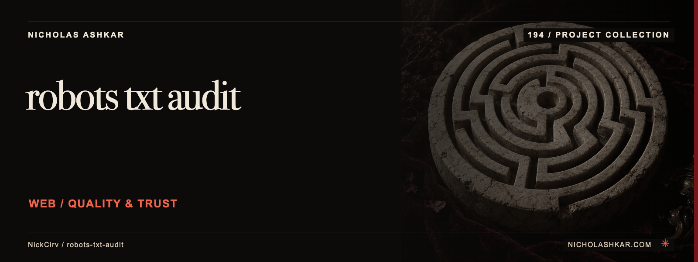

# robots-txt-audit

Inspect a site’s robots.txt for common configuration signals and selected crawler rules.

Fetches `/robots.txt`, parses user-agent blocks and reports issues, sitemap presence and a heuristic score. `--ai` limits output to the built-in AI crawler view: a per-bot ALLOWED/BLOCKED table covering GPTBot, ChatGPT-User, ClaudeBot, Claude-Web, anthropic-ai, PerplexityBot, Google-Extended, CCBot, Bytespider, Amazonbot and several others, each verdict annotated with the robots rule that decided it.


<a id="install"></a>

## Quickstart

Package runtime requirement: Node.js `>=20`. Git is needed to obtain the source checkout.

```bash
git clone https://github.com/NickCirv/robots-txt-audit.git
cd robots-txt-audit
node index.js https://www.nytimes.com --ai
```

This example was executed against the live nytimes.com robots.txt during the October 2026 revision. It printed BLOCKED for the AI training crawlers under that file's `Disallow: /` groups and ALLOWED for Amazonbot, whose only disallow there is `/wirecutter/`; rerunning it reflects whatever the site serves at that moment.


<a id="what-it-checks"></a>

<a id="ai-crawlers-tracked"></a>

<a id="scoring"></a>

## Usage

```bash
node index.js https://your-domain.example
node index.js https://your-domain.example --ai
node index.js https://your-domain.example --json
node index.js https://your-domain.example --ai --path /blog/post
```

Use a domain you administer for operational checks. Failed retrievals produce errors; a missing robots.txt has a separate report path. `--json` emits the report as machine-readable JSON; `--path` evaluates crawler access for a specific path instead of the default `/`.

[Command reference](docs/REFERENCE.md) covers arguments, modes and output controls.


<a id="what-it-is-not"></a>

## Behavior and limits

Rule evaluation follows [RFC 9309](https://www.rfc-editor.org/rfc/rfc9309): user-agent groups are selected by exact case-insensitive token match with fallback to `*`, duplicate groups for the same token are merged, and the rule whose pattern matches the most octets decides the verdict, with Allow winning ties. Patterns support the `*` wildcard and the `$` end anchor, and percent-encodings are canonicalized before comparison. Each verdict describes one path at a time (default `/`; change it with `--path`). These behaviors are asserted by the test vectors in `test/match.test.js`.

What a verdict cannot promise: robots.txt is advisory. A compliant crawler honors it; nothing enforces it. In August 2025 Cloudflare [documented Perplexity fetching content through undeclared, rotating crawlers](https://blog.cloudflare.com/perplexity-is-using-stealth-undeclared-crawlers-to-evade-website-no-crawl-directives/) after its declared bots were blocked, so treat BLOCKED as a statement of policy, not of access control. In the other direction, network-level defaults can block crawlers your file allows: on July 1, 2025 Cloudflare [changed its default to block AI crawlers](https://blog.cloudflare.com/content-independence-day-no-ai-crawl-without-compensation/) unless they have permission, which is a reason to audit your effective crawler access deliberately rather than assume the file is the whole story.

The built-in crawler list may age, and the score does not establish SEO performance or AI visibility. There is no dedicated successful `--help` branch; provide a URL.

## Development

Declared package scripts:

| Script | Command |
| --- | --- |
| `start` | `node index.js` |
| `test` | `node --test` |

The suite syntax-checks the entrypoint and runs 17 RFC 9309 matching vectors against the exported parser and matcher (18 tests total, `node --test`). Network behavior is exercised manually, not in the suite.

## Research

[Source review and claim ledger](docs/RESEARCH.md) records revision `e9539ea8adb3`, inspected files and verification gaps. That ledger predates the October 2026 matching rewrite described above.

## License and attribution

Protected license and attribution files remain unchanged: [LICENSE](https://github.com/NickCirv/robots-txt-audit/blob/e9539ea8adb38922e73a8d460e93505e24dfdc86/LICENSE).

[Artwork credits](assets/nicholas-ashkar/CREDITS.md) · [Nicholas Ashkar — consulting](https://nicholashkar.com/#oxblood-contact)
